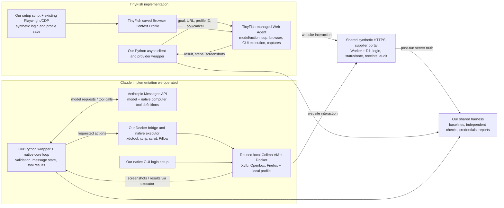

# Engineering ownership audit: TinyFish Web Agent versus our Claude Computer Use implementation

Audited 22 October 2026. **No new agent requests, benchmark runs, portal changes or environment startup.** Existing results and original evidence remain unchanged. This audit compares the implementation we operated, not the minimum code required by either vendor.

**Finding:** TinyFish removed our need to operate a desktop/browser execution host, implement low-level GUI actions, and run the model/action/screenshot feedback loop. It did **not** remove our API client, login bootstrap, credentials handling, task policy, result validation, evidence collection or application responsibilities. Both implementations reused login successfully. Claude was faster and had a lower API estimate in the three successful new runs. Engineering hours, production maintenance and all-in ownership costs are **UNKNOWN**. [Measured results](combined-results.json) · [Existing setup account](SETUP.md).

## 1. Source scope and measurement rules

I read the original private cloud adapter and utilities, supplier runners/setup clients, effective uncapped Claude core, original Docker bridge/native executor, image/startup/provisioning recipes and dependency manifest. [Seven source cross-checks](engineering-audit/private-source-crosscheck.json) confirm that the public execution snapshots match those private originals or their exact extracted functions. Additional original environment files are copied byte-for-byte into [audit support](engineering-audit/source-provenance.json); no credentials or private account dumps were copied.

The effective implementation is attempts 4–6, with the pilot implementation retained as history. The wrapper extracts TinyFish functions and replaces the old credential-file assignment with RAM keys; it also overrides the old default `use_profile:false`. Thus reading the base adapter alone would describe the wrong authentication behavior. See [bootstrap/wrapper lines 43–52 and 71–75](uncapped-followup/harness/executed-source/run_workflows.py#L43), [actual request](uncapped-followup/runs/tinyfish/attempt-04/actual-submission-payload.json), and [profile attached in provider evidence](uncapped-followup/runs/tinyfish/attempt-04/provider-run.json).

Counts are reproducible using this **offline** command from this directory:

```sh
python engineering-audit/measure_code.py
```

The [inventory](engineering-audit/code-inventory.json) assigns disjoint effective source slices to providers and shared plumbing. “Code-bearing lines” excludes Python comments/docstrings and blank lines, using tokens; shell/Docker counts exclude blank/comment lines. Physical lines include formatting; Python AST statements count multiple statements on a compressed line separately. Dependency/library code, duplicate pilot versions, other providers, manifests, report-generation scripts and shared portal code are not silently charged to one provider. Imported but dormant grading code is explicitly retained in Claude's footprint. **These are source-footprint measurements, not minimum production implementations, engineering hours, or a claimed percentage reduction in development effort.**

| Audited provider-specific footprint, including test instrumentation | TinyFish | Claude |
|---|---:|---:|
| Source files/sliced units | 3 | 8 |
| Physical lines | 111 | 1,044 |
| Code-bearing physical lines | 109 | 954 |
| Python AST statements; shell/Docker excluded | 212 | 628 |
| Developer-operated execution image/startup recipe | None | Dockerfile + desktop start script |
| Developer-operated GUI bridge/executor | None | `desktop.py` + native `action.py` |
| Timed initial authenticated setup | 22.62 s | 21.94 s |
| Timed session refresh before new batch | 21.96 s | 21.16 s |

TinyFish's dense one-line Python makes physical-line ratios especially misleading: its 109 code-bearing lines contain 212 statements. Claude's core includes a recorder, costs, summaries and unused generic grading branches. The counts demonstrate a different ownership boundary, not “nine times less engineering.” Shared utility/driver slices add another 183 physical / 177 code-bearing lines, **once for the experiment**, excluding the shared portal and additional test/publication tooling. The old 24-line Mac provisioning recipe is separately inventoried as historical bootstrap, not work repeated for this experiment.

Concrete test-centric portions within the Claude total include its 67-line Recorder (core 110–176), 52-line dormant automatic-grading branch (404–455), 19-line address-bar observation helper (desktop 82–100) and 34-line imported answer/title/URL matcher functions (evaluation 8–41). They are **not an additional subtotal**. The recorder could be replaced by production telemetry; the unused graders are not required for supplier interaction. Remaining code still mixes execution, accounting and evidence, so subtracting these slices would not produce a defensible minimum-production LOC count. [Recorder](uncapped-followup/harness/executed-source/uncapped_core.py#L110) · [grading branch](uncapped-followup/harness/executed-source/uncapped_core.py#L404) · [URL observer](harness/executed-source/claude/desktop.py#L82) · [matchers](engineering-audit/source/claude-evaluation.py#L8).

## 2. Actual architecture


[Editable SVG](engineering-audit/architecture.svg). The login bootstrap is separate from scored execution; the shared fixture and verification belong to neither provider. The equivalent Mermaid below preserves the detailed message/feedback relationships in text form.



The TinyFish internals are a service boundary, not inspected source: the request/result contract, retained UI captures and server activity demonstrate remote execution, not how its private controller works. Claude's model was remote too; **the model was not running on the M1**. Our Mac hosted its execution environment and orchestrator. [TinyFish submit/poll](harness/executed-source/tinyfish-adapter-original.py#L14) · [Claude model request](uncapped-followup/harness/executed-source/uncapped_core.py#L292) · [Docker/action bridge](harness/executed-source/claude/desktop.py#L36).

## 3. Component and dependency inventory

| Component | Classification | Actual use and source |
|---|---|---|
| TinyFish async adapter | Developer-written, reused provider integration; 41 physical lines | Two extracted functions submit once, poll, enforce deadline, cancel on error/time limit and download results. [Adapter 1–41](harness/executed-source/tinyfish-adapter-original.py#L1). No local per-action dispatch or screenshot feedback loop. |
| TinyFish supplier wrapper | Developer-written provider integration plus test instrumentation; 33 selected lines | AST reuse/bootstrap 46–47; overrides, accounting and access checks 62–92. [Effective wrapper](uncapped-followup/harness/executed-source/run_workflows.py#L46). Poll interval is changed from four seconds to one in memory. |
| TinyFish authenticated setup | Developer-written setup using reused dependency; 37 lines | Existing Playwright attaches to the provider's CDP setup session, logs in, hashes the cookie only for attribution, saves profile and closes attachment; cancels unsuccessful setup. [Setup 15–36](uncapped-followup/harness/executed-source/setup_tinyfish_profile.py#L15). It does not execute scored supplier edits. |
| TinyFish runtime and profile storage | Provider-managed | Actual `use_profile:true`, dedicated profile ID and `profile_attached:true`; [request](uncapped-followup/runs/tinyfish/attempt-04/actual-submission-payload.json), [provider record](uncapped-followup/runs/tinyfish/attempt-04/provider-run.json), [session audit](uncapped-followup/runs/tinyfish/attempt-04/server-verification.json). Reusing a saved profile did not mean we implemented automatic reauthentication. |
| Claude effective native core | Developer-written, reused and instrumented; 568 lines | Maintains conversation, calls model, validates actions, executes ordered batches, forwards results/images and saves trace/usage. Contains generic grader branches not used by this portal. [Core 179–568](uncapped-followup/harness/executed-source/uncapped_core.py#L179). Only three cost-stop conditions were removed for the new batch; [diff](uncapped-followup/core-spending-guard-removal.diff). |
| Claude Docker bridge | Developer-written reused module; 129 lines | Subprocess transport, readiness polling, resource-constrained container startup and ownership-checked removal. Includes an unused address-bar grader helper, lines 82–100. [Bridge/lifecycle](harness/executed-source/claude/desktop.py#L14). |
| Claude native action executor | Developer-written reused module; 190 lines | Coordinates, keys/modifier release, clipboard typing, pointer/scroll/drag, screenshot/zoom, safe error categories. [Executor 69–190](harness/executed-source/claude/native-action.py#L69). |
| Claude image and startup | Developer-owned recipes on reused infrastructure; 13 + 20 lines | Image installs tools and runs as `agent`; startup supplies display/window manager and Firefox profile. [Dockerfile](engineering-audit/source/claude-Dockerfile#L1), [startup](engineering-audit/source/claude-start.sh#L3). Colima/Docker are reused; no image rebuild in authenticated setup. |
| Claude login + supplier wrapper | Developer-written setup/integration; 42 + 32 selected lines | Native keyboard login, clipboard clear, same context across attempts; wrapper resets only view to `about:blank`, SDK retries zero, invokes core and captures final evidence. [Setup](uncapped-followup/harness/executed-source/setup_claude_context.py#L13), [wrapper 48–52, 93–119](uncapped-followup/harness/executed-source/run_workflows.py#L93). |
| Claude imported evaluation helpers | Reused test-oriented utility; 50 lines | Core imports answer/title graders and output redaction; desktop imports URL matcher. Portal success uses the separate server verifier, not these generic graders. [Utility](engineering-audit/source/claude-evaluation.py#L8), [manual-grading branch](uncapped-followup/harness/executed-source/uncapped_core.py#L400). |
| HTTP/redaction/capture helpers | Shared reused harness, not unique TinyFish product code | Initialization/imports 1–7 and 9–10, helpers 11–38 and 66–76 are counted. Its old credential-file assignment and old budget/claim functions are replaced, not active policy. It still reads the earlier task-manifest JSON during module initialization; the wrapper replaces `TASKS` before the supplier call. That legacy file/path is a real benchmark dependency, not a production requirement. [Shared helper](harness/executed-source/common-original.py#L11), [replacement](uncapped-followup/harness/executed-source/run_workflows.py#L46). |
| Credential broker / fixture client | Shared custom setup and test plumbing | Owner-only RAM IPC; owner verifier/service authentication; no keys in goals. [Broker](harness/executed-source/credential-broker.py#L1), [fixture client](uncapped-followup/harness/executed-source/fixture_client.py#L6). This is not a deployed production secrets service. |
| Target portal | Shared application/fixture; neither provider-specific | 72-line Worker, SQL schema/migration journal, build script, artifact validator, hosting template and package manifest. Worker uses Web APIs and D1, with no imported runtime npm library. Production-like login/save/receipt functions coexist with test-only seed/reset/verify/expiry APIs. [Worker 11–68](fixture/worker/index.js#L11), [schema](fixture/drizzle/0000_supplier_fixture.sql), [build](fixture/scripts/build.sh#L9), [package](fixture/package.json). Not rebuilt during this audit. |
| Benchmark orchestration and independent proof | Shared, predominantly test-only | Paired records/prompts, baselines, no-restart markers, audits/claims, grades, screenshot review, hashes, offline regrades and publication. [Batch 120–146](uncapped-followup/harness/executed-source/run_workflows.py#L120), [fixture QA](harness/executed-source/validate_fixture.py#L21), [offline regrade](verify_complete_experiment.py). A production application would replace the synthetic fixtures/rubric with its real correctness and authorization checks. |
| Cleanup and reporting | Shared evidence collection, plus Claude-specific host teardown | Server snapshots/session revocation/wallet observations; container/VM stop in finalizer. [Collector](uncapped-followup/harness/executed-source/finish_evidence.py#L6), [finalizer 13–20](uncapped-followup/harness/executed-source/finalize_runtime.py#L13). Private packaging scripts produced the public copies/reports; not needed to run the business workflow. |

**Direct dependencies, not entire transitive dependency trees:** TinyFish's scored client uses Python standard-library HTTP/JSON/threading/base64; no TinyFish SDK was used. Its setup additionally imports existing `playwright.async_api`; it attaches remotely, not a locally launched browser. Claude's host core uses `anthropic` plus standard library; its executor uses Pillow and the `xdotool`, `xclip`, `scrot` binaries. Docker image runtime additionally supplies Xvfb, Openbox, Firefox ESR, CA certificates and fonts. Image build uses Python and `uv`; Mac provisioning uses Docker, Colima, Homebrew and `uv`. The original project declares `python-dotenv` but the supplier runner does not import it; pytest/httpx2/Pillow/ruff in its dev group are not all scored-runtime requirements. [Imports/core](uncapped-followup/harness/executed-source/uncapped_core.py#L3) · [executor imports](harness/executed-source/claude/native-action.py#L3) · [image dependencies](engineering-audit/source/claude-Dockerfile#L1) · [manifest](engineering-audit/source/claude-pyproject.toml#L5) · [historical provisioning](engineering-audit/source/claude-setup-mac.sh#L12).

The active Python source units alone are not a complete deployable package: installed SDKs, existing image/VM, source-loading paths and shared helpers remain prerequisites. Empty package markers and dependency lockfiles are metadata rather than separately counted integration logic. The 1,044-line footprint is deliberately not advertised as 1,044 new lines written for this supplier task.

## 4. Representative execution code

These are short, noncontiguous excerpts; benchmark reporting is omitted and indentation is normalized. They are evidence, not new runnable benchmarks. No credentials are included.

TinyFish: our code submits and observes a service job. The wrapper supplies the saved-profile fields before submission. [Submit line 14; poll line 21](harness/executed-source/tinyfish-adapter-original.py#L14), [actual profile override line 73](uncapped-followup/harness/executed-source/run_workflows.py#L73):

```python
r=api(agent,'/v1/automation/run-async',payload,timeout=45)
r=api(agent,'/v1/runs/'+state['run_id'],timeout=min(25,max(1,600-(time.monotonic()-start))))
```

Claude: our code submits model messages, dispatches the returned GUI actions and sends their results back into the next turn. [Core lines 292, 493–495, 532](uncapped-followup/harness/executed-source/uncapped_core.py#L292):

```python
request = dict(model=MODEL, system=SYSTEM, tools=TOOLS, messages=messages)
action = desktop.execute(
    block["name"], block["input"], timeout=min(310, remaining)
)
messages.append({"role": "user", "content": results})
```

The extra work is concrete, below that loop: [executor lines 70–102](harness/executed-source/claude/native-action.py#L70) capture PNGs with `scrot`, crop/resize zooms with Pillow and base64-encode images; [bridge 49–59](harness/executed-source/claude/desktop.py#L49) moves JSON through `docker exec`; [core 468–532](uncapped-followup/harness/executed-source/uncapped_core.py#L468) preserves tool IDs/toolset names and stops dependent batch actions after an error. Our TinyFish client downloads provider captures for the report; it does not generate and forward each screenshot into TinyFish's model loop.

## 5. Reconstructing setup effort without inventing hours

All human-readable times below are **22 October 2026, WAT (Africa/Lagos, UTC+1)**; linked JSON retains original UTC timestamps. Windows are elapsed event intervals, not developer labor. Work overlapped and no time sheet exists.

| Work category | What the records establish | What remains UNKNOWN |
|---|---|---|
| 1. Synthetic portal | Source commits `65c1f6f` at 17:31:16 and `9955044` at 17:39:23; seed failure 17:39:02; 12 QA checks passed by 17:41:37. The repaired build copies migrations at line 11. [Source cross-check/history](engineering-audit/private-source-crosscheck.json), [failure](fixture-qa-attempt-1-error.json), [QA](fixture-qa.json), [build](fixture/scripts/build.sh#L11). | Isolated portal design/coding/deployment hours; commit spacing is not coding time. |
| 2. TinyFish integration | Reused adapter; dedicated profile created through API; new supplier wrapper and setup script. Create response was HTTP 201, but its raw creation timestamp has no timezone. API login/save took 22.62 s, 17:42:29–17:42:51; refresh 21.96 s, 20:40:32–20:40:54. [Initial](setup/tinyfish-profile-setup.json), [refresh](uncapped-followup/tinyfish-profile-setup.json), [creation observation](engineering-audit/profile-creation-observation.json). | Time spent reading docs, earlier adapter development, profile selection/creation duration and total integration labor. |
| 3. Claude integration | Reused native loop, image, bridge/executor and existing Colima VM. Setup reports `image_rebuilt:false`. New supplier wrapper changed task authorization and reused context; uncapped core removed three spending checks. [Setup](setup/claude-context-setup.json), [wrapper 48–52](uncapped-followup/harness/executed-source/run_workflows.py#L48), [core diff](uncapped-followup/core-spending-guard-removal.diff). | Original environment construction/install/build hours, isolated startup time and total new adaptation hours. Original Claude directory has no local Git history; timestamps/recipes cannot recover the missing labor record. |
| 4. Harness | Shared audit began 17:19:36; first pilot orchestration marker 17:50:40: about 31 minutes covering overlapping fixture, integrations and QA. New preflight 20:41:36, runner start 20:41:37. [Preparation](evidence/preparation.json), [pilot start](evidence/benchmark-started.json), [new preflight](uncapped-followup/preflight-checks.json). | Per-provider shares of that window; original harness engineering hours. The existing “roughly three minutes” amendment preparation is an approximate elapsed account, not an independently isolated labor measurement. |
| 5. Authenticated sessions | Claude initial native setup 21.94 s, 17:43:43–17:44:05; refresh 21.16 s, 20:40:47–20:41:08. Each logged 11 setup actions, plus readiness/title checks. TinyFish timings above include profile API/CDP work. Both kept cookies across three attempts per phase. [Initial](setup/claude-context-setup.json), [refresh](uncapped-followup/claude-context-setup.json). | Human setup time, full provisioning time, production reauthentication effort. Scripted login timings are not total setup time and are not exactly equivalent operations. |
| 6. Recovery/repair | Migration/archive repair: first failed QA to successful QA about 154.87 s, inclusive of other work. Wrong interpreter at 20:40:33: reused installed Playwright venv, no installation or model retry. Collector exited 1 at 20:55:40; one read-only retry recorded successful by 20:57:19. [Interpreter error](uncapped-followup/setup-interpreter-error.json), [collector](uncapped-followup/final-collection-status.json), [retry](uncapped-followup/collection-retry.json). | Exact coding/repair duration for each incident; collector root cause because stderr was suppressed. These are setup/collector faults, not failed agent GUI decisions. |

The earlier synthetic-admin schema error is recorded in [preparation](evidence/preparation.json): an unused value was replaced before deployment; exact repair duration is UNKNOWN. The watchdog's two early stops were **our harness policy**, not provider infrastructure failures. Their investigation and amendment remain [unchanged](WATCHDOG-INVESTIGATION.md). No recovery advantage should be inferred from those incidents.

**Operator steps:** TinyFish required checking existing profiles/Vault availability, choosing/creating a dedicated profile, invoking the setup script with the correct existing environment, confirming profile-save evidence, passing its ID, then checking terminal runs and revoking test sessions. Claude required ensuring the dedicated Colima VM was running, starting/claiming the owned container, invoking native login setup, keeping that same container for the batch, then stopping/removing it and the VM. Scripts performed the actual login for both; these are operator responsibilities, not claims that a person clicked through every login. API keys were supplied via RAM IPC; no password was given to either agent. Exact manual interaction counts and active human minutes are UNKNOWN. [TinyFish setup](uncapped-followup/harness/executed-source/setup_tinyfish_profile.py#L20) · [Claude setup](uncapped-followup/harness/executed-source/setup_claude_context.py#L13) · [cleanup](uncapped-followup/harness/executed-source/finalize_runtime.py#L15).

## 6. Operational responsibility matrix

P = provider service; C = our custom code; R = reused developer-operated infrastructure; S = shared application/test logic. “Potential production duty” is an ownership inference from these boundaries, **not measured maintenance work**.

| Responsibility | TinyFish in this implementation | Claude in this implementation | Remaining duty / source evidence |
|---|---|---|---|
| Model inference and tool planning | P: Web Agent | P: Anthropic model | Select authorized task/model, validate outcomes; [adapter](harness/executed-source/tinyfish-adapter-original.py#L14), [core](uncapped-followup/harness/executed-source/uncapped_core.py#L330). |
| Browser/desktop hosting | P: remote browser | R+C: Colima, Docker, image, X display, Firefox | TinyFish removed our local execution host. We still run an HTTP client and shared application. [Dockerfile](engineering-audit/source/claude-Dockerfile), [startup](engineering-audit/source/claude-start.sh). |
| Browser lifecycle | P internal lifecycle; C submits, polls and cancels runs | C container lifecycle/readiness; R VM; startup trap terminates Firefox | We still enforce deadlines, verify terminal status and handle abandoned/uncertain jobs; [TinyFish 9–28](harness/executed-source/tinyfish-adapter-original.py#L9), [Claude start/stop](harness/executed-source/claude/desktop.py#L103). |
| Action execution / feedback loop | P; internals opaque | C ordered tool dispatch, JSON transport, low-level actions/results | TinyFish removed these executor/loop modules from our stack. [Core 466–532](uncapped-followup/harness/executed-source/uncapped_core.py#L466), [executor](harness/executed-source/claude/native-action.py#L69). |
| Screenshot generation and model forwarding | P during agent run; C downloads report images | C scrot/Pillow/base64, core returns image tool results | Both retained our evidence policies and storage/redaction; [capture helper](harness/executed-source/common-original.py#L66), [native capture](harness/executed-source/claude/native-action.py#L70). |
| Login/bootstrap | C existing Playwright + P setup browser | C native GUI login in R Firefox | We establish authorized access; neither agent received passwords. [Setup sources](uncapped-followup/harness/executed-source/setup_tinyfish_profile.py#L24), [native setup](uncapped-followup/harness/executed-source/setup_claude_context.py#L22). |
| Session persistence | P saved profile restored for runs; C selects profile | R same live Firefox profile/container; C keeps it alive | S portal owns validity/expiry. Claude session did not survive container removal; cross-restart restore was not implemented/tested. [Profile save](uncapped-followup/harness/executed-source/setup_tinyfish_profile.py#L27), [Firefox profile](engineering-audit/source/claude-start.sh#L6), [server expiry](fixture/worker/index.js#L50). |
| Credentials and policy | C+S RAM broker/bootstrap; P saved browser session | C+S broker/native login; own browser cookie storage | Key rotation, scope, consent, access revocation and production secret storage remain ours. TinyFish Vault was not configured. [Broker](harness/executed-source/credential-broker.py#L1), [client](uncapped-followup/harness/executed-source/fixture_client.py#L6), [server revocation](fixture/worker/index.js#L27). |
| Scaling/concurrency | P execution host; C would schedule/account for jobs | R+C would need multiple isolated runtimes and routing; singleton implementation | Only sequential runs observed. No fleet manager, scale test, throughput or scaling-cost evidence for either. [Sequential driver](uncapped-followup/harness/executed-source/run_workflows.py#L129), [single named container](harness/executed-source/claude/desktop.py#L9). |
| Transport/errors/retries | C HTTP error handling, cancellation, no automatic benchmark restart; P internal retries unknown | C zero SDK retries, timeout/error accounting, halt dependent actions; model may replan next turn | We still need production idempotency, incident handling and safe retry policy; those are not proved by three successes. [HTTP](harness/executed-source/common-original.py#L24), [SDK config](uncapped-followup/harness/executed-source/run_workflows.py#L100), [batch halt](uncapped-followup/harness/executed-source/uncapped_core.py#L473). |
| Expired-login/crash recovery | NOT TESTED as agent behavior; Vault absent | NOT TESTED as agent behavior; no durable browser restore | Fixture expiry QA and cleanup are not recovery benchmarks. [QA](fixture-qa.json), [cleanup](uncapped-followup/session-cleanup.json). |
| Monitoring/trace collection | P run/result/step/image data; C poll/store/wallet deltas | C Recorder, raw SDK responses, actions/errors/cost timing | Neither implementation has a measured production alerting/on-call/SLO system. [TinyFish trace](uncapped-followup/runs/tinyfish/attempt-04/provider-run.json), [Recorder](uncapped-followup/harness/executed-source/uncapped_core.py#L110). |
| Business correctness / audit | S owner-side checks + C result parsing | Same S+C | Still our responsibility; a provider success status is not business proof. [Verifier](uncapped-followup/harness/executed-source/run_workflows.py#L120), [independent regrade](verify_complete_experiment.py). |
| Security updates / isolation | P browser runtime; C client/dependencies; S application | R+C VM/image/OS/browser/executor; P model API | This allocation suggests different patching duties, but no patch cadence, security review effort or maintenance savings was measured. [Image](engineering-audit/source/claude-Dockerfile#L1), [container isolation](harness/executed-source/claude/desktop.py#L110). |

## 7. Claude alternatives: what this comparison does not establish

Checked against current primary documentation on 22 October 2026; **none of these alternatives was installed or benchmarked**:

* Anthropic's native Computer Use is a client toolset whose actions run in an environment the application controls. That explains our implementation choice, not a universal requirement for a local Mac/Colima setup. [Computer Use documentation](https://platform.claude.com/docs/en/agents-and-tools/tool-use/computer-use-tool).
* Anthropic **Browser Use** operates on page structure and browser state as well as screenshots; it does not require a full desktop. It is also client-executed, not an Anthropic-hosted browser. [Browser Use documentation](https://platform.claude.com/docs/en/agents-and-tools/tool-use/browser-use-tool).
* The Python/TypeScript SDK toolsets can handle orchestration and configured checks with a supplied driver. Anthropic lists Browser Use, Browserbase, Daytona and E2B drivers; a custom executor like ours is not the only integration route. [SDK toolsets guide](https://platform.claude.com/docs/en/agents-and-tools/tool-use/browser-use-sdk).
* **Claude Managed Agents** supplies a hosted harness/runtime and session events. Its documented built-ins include shell/file/web tools and MCP. The native Browser/Computer Use client toolsets above are currently documented as unavailable directly in Managed Agents; do not equate every “browse” capability with that exact native tool protocol. [Managed Agents overview](https://platform.claude.com/docs/en/managed-agents/overview), [client-tool availability](https://platform.claude.com/docs/en/agents-and-tools/tool-use/browser-use-tool).
* Browserbase documents pairing Managed Agents with a Browserbase Chromium/CDP session through the `browse` CLI, credentials and configured environment. Kernel separately documents managed browser integration using Managed Agents credential vaults. These can shift hosting/execution ownership too, but introduce another integration/service and were not costed or tested here. [Browserbase integration](https://docs.browserbase.com/integrations/anthropic/managed-agents/introduction), [Kernel integration](https://www.kernel.sh/blog/claude-managed-agents).

Therefore the evidence supports **“TinyFish simplified our chosen self-operated Claude Computer Use stack,”** not “Claude requires developers to build all this themselves” or “TinyFish uniquely offers managed browser execution.” A fair comparison with a managed Claude/browser integration would be a different experiment, with separate authorization, costs and results.

## 8. Cost-of-ownership framework

| Ownership term | Observed TinyFish | Observed Claude | Treatment |
|---|---:|---:|---|
| New successful workflows | 3/3; 179.32 s mean | 3/3; 67.39 s mean | Existing measured cases only; [results](combined-results.json). |
| New batch API usage/estimate | $1.120000; $0.373333 per verified workflow | $0.746342; $0.248781 per verified workflow | TinyFish step/wallet observations versus Claude saved token tariff; not equivalent invoice evidence. |
| All-six API accounting | $1.472000 known + $1.20 unresolved cancellation reserve | $1.498172 token estimate | Preserve censored attempts. Reserve is neither confirmed charge nor hard upper bound. [Costs](COSTS.md). |
| Browser execution hosting | Included in managed product boundary; separate allocation UNKNOWN | Existing local Mac/Colima/Docker; cash allocation UNKNOWN | No standalone hosting price or valid zero-cost inference. |
| Synthetic portal hosting/database | Same shared Sites/Worker/D1 fixture | Same | Allocation UNKNOWN; benchmark fixture is not a differential vendor cost. |
| Setup/profile use | Recorded timings, zero observed wallet change at setup checks; initial $0.02 uncertainty allowance retained | Recorded native setup timings; local runtime unpriced | A zero observed change is not proof of free setup. |
| New/historical engineering | Source footprint measured; labor UNKNOWN | Source footprint measured; reused build/install effort UNKNOWN | No LOC-to-hours conversion. |
| Maintenance, incidents, security, fleet, on-call | UNKNOWN | UNKNOWN | Responsibility allocation is documented; savings/reliability not measured. |

A usable model is **ownership cost = provider usage + execution hosting + shared application cost + integration/setup labor + ongoing maintenance/incident cost**. All terms need measured prices/time and an allocation period. For one provider to be cheaper overall, its measured API/hosting difference must be combined with evidence for those other terms. This experiment cannot price a break-even point or establish total savings.

## Answer to the developer question

**Yes, relative to our actual self-operated implementation, TinyFish reduced the execution infrastructure and integration surface we owned.** The strongest evidence is the absence of our own browser host, native executor and per-action model feedback loop on its side, versus the explicit Docker/Xvfb/Firefox/xdotool/scrot/Pillow components and client loop on Claude's side. Its saved profile also crossed separate remote runs, whereas our Claude context persisted only inside a live container. Neither difference proves better login recovery or production reliability.

**What remained:** secure setup, profile selection, authorization, run lifecycle/deadlines, errors and cost reconciliation, outcome verification, observability retention and the real application's correctness. Claude retained direct action/runtime control, readable executor source and lower measured time/API cost here. Current managed Claude/browser options could change the infrastructure comparison; this audit does not assign them invented results. [Article-ready account](ENGINEERING-EFFORT-ARTICLE.md).

Claude also exposed the requested/returned model alias and per-action execution/error records, while TinyFish's controller and exact model revision were opaque. That is a concrete inspection/control advantage of our chosen stack, not a measured reduction in debugging time. Its native executor has a desktop-wide mouse/keyboard surface; this supplier-only experiment does not establish broader desktop-task performance. [Model/tool metadata](uncapped-followup/runs/claude/attempt-04/run-record.json) · [action recorder](uncapped-followup/harness/executed-source/uncapped_core.py#L524) · [TinyFish revision limitation](uncapped-followup/runs/tinyfish/attempt-04/run-record.json).
