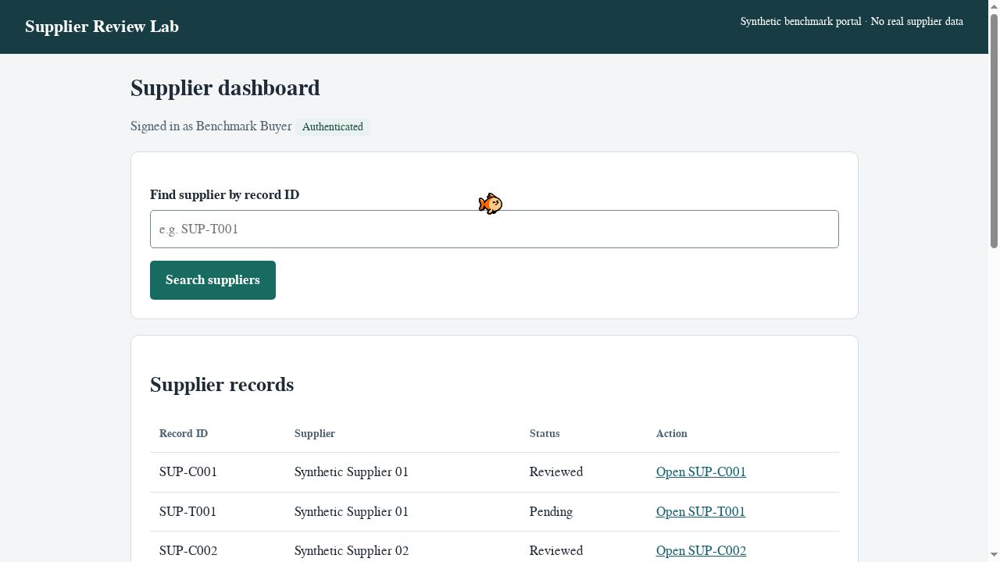
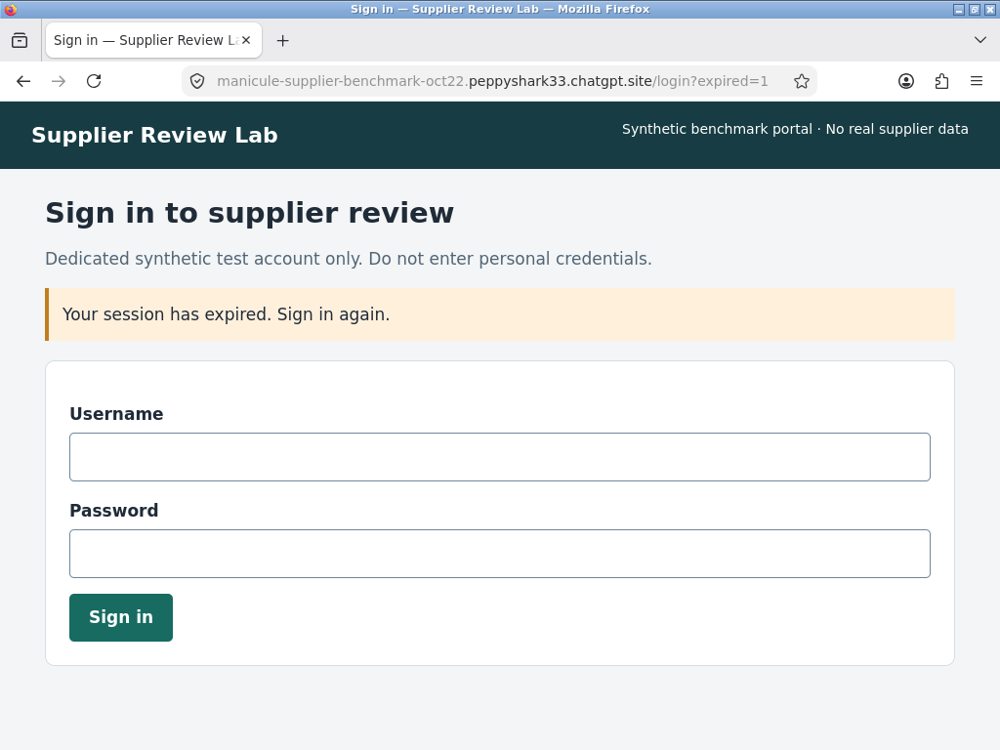
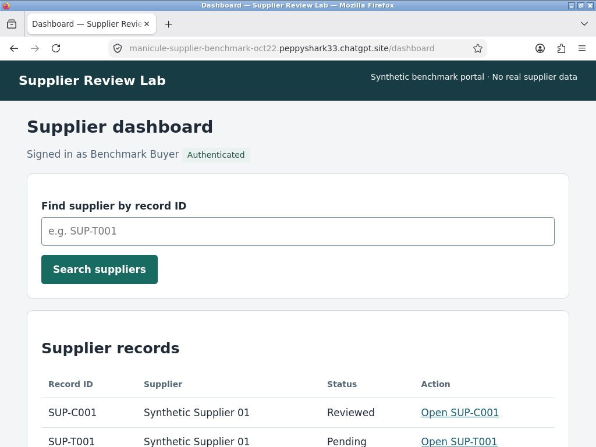

# Independently verified results

| Measurement | TinyFish saved Profile | Claude original | Claude persistent profile |
|---|---:|---:|---:|
| Authentication restored | Yes | No | Yes |
| Read-only diagnosis correct | Yes | Yes | Yes |
| Login/profile setup routine | 20.46 s | 15.15 s | 13.82 s |
| Dedicated Profile creation | 0.97 s | N/A | N/A |
| Container shutdown/removal | Not exposed | 25.89 s | 25.72 s |
| New local container to browser ready | Not exposed | 3.42 s | 2.29 s |
| Agent execution | 36.94 s | 22.03 s | 20.98 s |
| Recorded actions | 3 provider steps | 8 native actions | 8 native actions |
| Agent screenshots | 2 | 3 | 3 |
| Additional setup/final stills | 1 | 2 | 2 |
| Generation requests | Not exposed | 4 | 4 |
| Token-count requests | Not exposed | 4 | 4 |
| API retries | Not exposed | 0 | 0 |
| Model/tool revision | Not exposed; lite browser mode | claude-sonnet-5-5 / computer_toolset_20260801 | Same |
| Original native status | COMPLETED | needs_review | needs_review |
| Post-review diagnostic grade | PASS | PASS | PASS |
| Agent errors | No client error; internals not exposed | 0 | 0 |
| API usage value | $0.048000 wallet/steps | $0.058582 token estimate | $0.058560 token estimate |

`needs_review` is the reused native harness's deliberate manual-grading status, not a changed raw success flag. Original responses and summaries are preserved. The separate offline/manual grade checks the new diagnostic rubric; a negative authentication result can still be correctly diagnosed.

## What establishes restoration

TinyFish's new run reported `authenticated=true`, heading “Supplier dashboard,” account “Benchmark Buyer,” and `SUP-C001`. Its [server audit](runs/tinyfish/server-verification.json) attributes the dashboard access to the **same fresh setup session** after the local setup Python process, credential broker and browser clients had stopped. The new controller received no portal password, cookies or local browser files. The dedicated saved profile was attached and Vault was explicitly false. [Process evidence](setup/tinyfish-setup-shutdown.json), [new controller](runs/tinyfish/controller-identity.json), [submitted payload](runs/tinyfish/actual-submission-payload.json), [original response](runs/tinyfish/original-response.txt).

Claude original had different pre/post container IDs, no mounts, and a valid unrevoked setup session on the server immediately before the diagnostic. The new browser was redirected to `/login?expired=1`; the model correctly stopped without entering credentials. That generic notice says “Your session has expired,” but the server confirms the old session had **not** expired. Missing client state explains the observed loss. [Lifecycle](runs/claude-existing/lifecycle.json), [server verification](runs/claude-existing/server-verification.json), [original response](runs/claude-existing/original-response.txt).

Claude persistent had different container IDs with the **same named volume at `/home/agent/profile`**. Its authenticated dashboard access used its fresh setup session, without a new login. The model returned the required heading, account label and supplier ID. [Lifecycle/mount evidence](runs/claude-persistent/lifecycle.json), [server verification](runs/claude-persistent/server-verification.json), [original response](runs/claude-persistent/original-response.txt).

There were no agent logins or supplier writes during any diagnostic. All 20 complete supplier rows match the recovered pre-experiment native database snapshot. [Record comparison](evidence/supplier-records-comparison.json). Three newly created sessions were revoked **after** testing; this cleanup is not an expired-session recovery test. The original password hash/metadata and same saved portal version were restored successfully, owned containers/volume removed, VM stopped. [Portal restoration](evidence/portal-restoration.json), [runtime cleanup](evidence/runtime-cleanup.json).

## Screenshots

All 13 saved screenshots were reviewed at source resolution: three setup captures, eight agent frames and two independent final captures. No passwords, cookies, provider keys or personal data appear in them. Images are unaltered.
