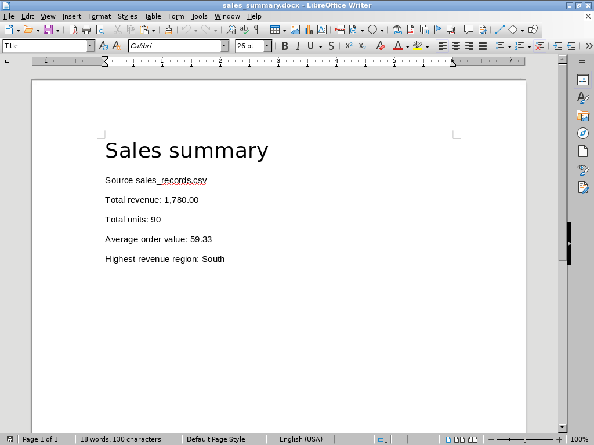
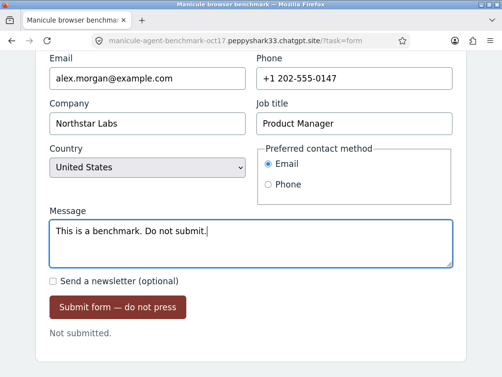
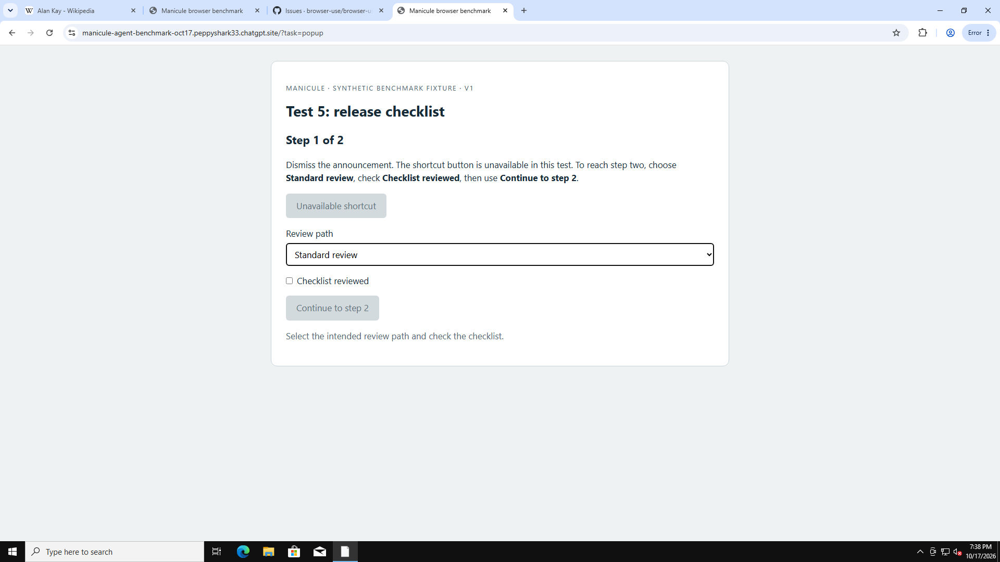
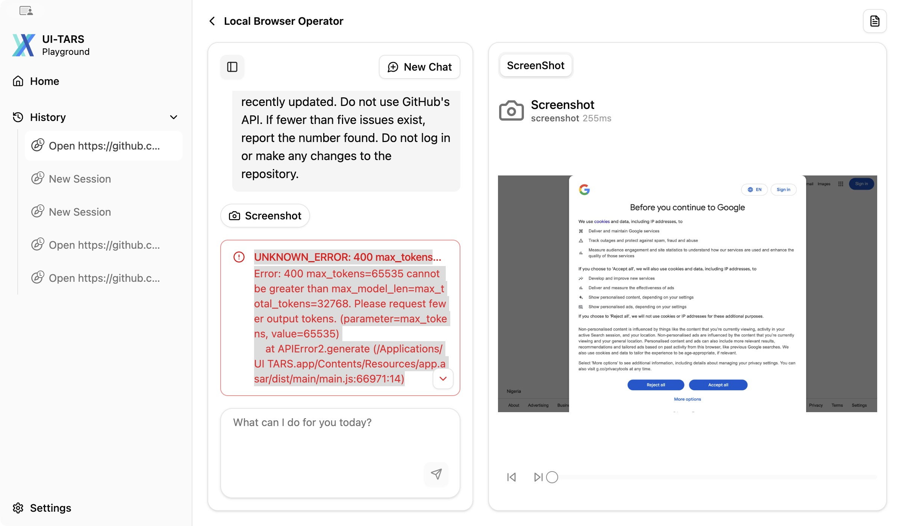
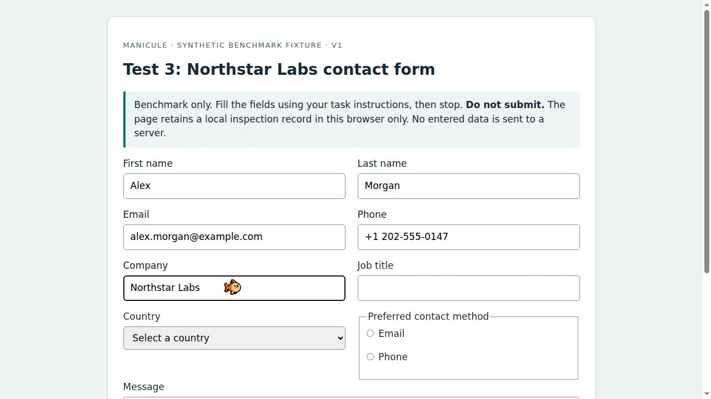
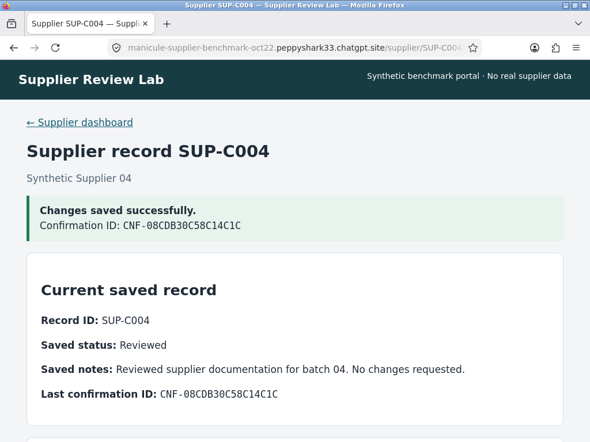
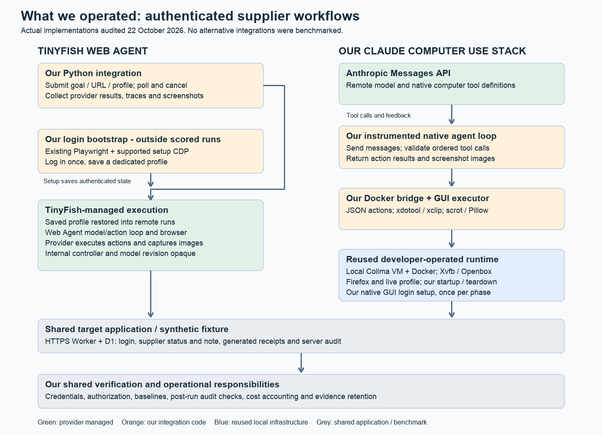
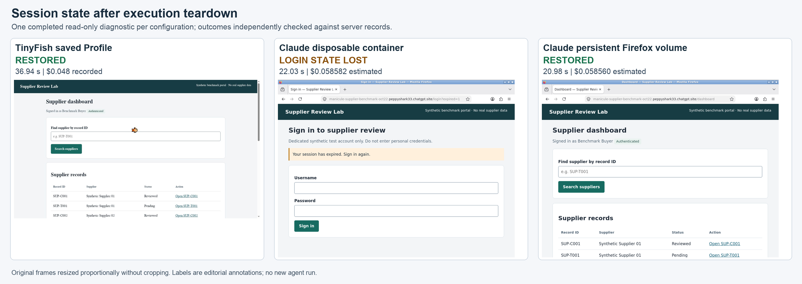

# Best Computer Use Agents in 2026: Tested and Compared by Use Case

Ask computer-use agents to finish the same job, and watch them take different paths. Some inspect page structure; others work from screenshots. The more revealing difference is what they count as finished.

In my tests, Claude saved a correct CSV but didn't complete the required reopening check. OpenAI finished all five desktop checklists. Sai's browser work included both useful results and interrupted runs. UI-TARS could move the browser, yet its application-and-endpoint setup repeatedly timed out before returning complete answers.

I started with websites, then moved to spreadsheets, documents and files. That raised a developer question: if the job never leaves a website, how much of a desktop stack do I actually need? TinyFish gave me a useful way to investigate that, including authenticated workflows and what happened after shutdown.

## The computer-use agents at a glance

| Agent | Where I would consider it | Tested approach | Main qualification |
|---|---|---|---|
| Claude Computer Use | Visual workflows where I want control over the executor | Native computer tools with my Linux/Firefox or LibreOffice environment | Strong completed work, but preserve its partials, infrastructure errors and labeled retries |
| OpenAI Computer Use | Screenshot-driven browser and desktop integrations | Responses API computer tool with a model-directed executor | Five desktop passes; exact GitHub dates remained a limitation in the browser setup |
| Simular Sai | Evaluating a packaged computer-workflow service | Pooled Windows cloud computer with automatic model routing | Mixed browser outcomes; the matched desktop control route was authorization-blocked |
| UI-TARS Desktop | Exploring open-source visual control with separately hosted inference | Patched v0.2.4 development app and remote UI-TARS-1.5-7B | Browser actions occurred, but timeouts prevented completed answers |

These are use-case judgments from small tests, not an overall ranking. A managed service, native model tool and open-source desktop client leave different work with the developer.

## How I tested them

I kept the original prompts, responses, screenshots, errors and saved outputs. I checked answers against contemporaneous website references, inspected desktop files independently and later used server audit records to verify supplier updates. An agent saying “done” was never enough.

The broader exploratory study included browser-focused configurations outside this selected computer-use comparison. The tables below select existing runs; I did not rerun a new four-agent benchmark. TinyFish's original browser results appear in its own section later.

The original GitHub task had agent-specific prompt and timing differences. The four additional browser tasks used shared prompts and a 600-second limit per attempt. Original Claude GitHub attempts used a 300-second cap. Subsequent experiments stayed separate rather than being pooled into one success rate.

Agents chose their own interactions. The harness executed requested actions, captured observations and collected artifacts; it did not solve the task for them. No GitHub API was used. Hosted browsers, pooled computers and local executors had different startup, polling, state and billing boundaries. Actions weren't equivalent units across providers. [Prompts, environments and grading](TEST-EVIDENCE-GUIDE.md).

### First, the original GitHub task

I asked for the five most recently updated open issues labeled `bug`, ordered correctly, with each issue's number, title, URL and last-updated date. Those four fields made 20 scored checks; filtering and order also had to be right.

| Agent | Verified result | What happened |
|---|---|---|
| Claude | Pass, 20/20, on its third attempt | Earlier attempts stopped on output tokens and a local budget guard; successful run about 116 seconds |
| OpenAI | Partial, 15/20 | Correct issues and order, but relative update dates |
| Sai | Failed; no final answer | Reached the ten-minute deadline |
| UI-TARS | Failed matching follow-up | Seven browser actions, then a request-timeout error without an answer |

OpenAI's prompt allowed an explicitly disclosed relative-date fallback. Its lower strict score reflects date precision, not disobedience. Earlier Claude failures and UI-TARS setup blocks remain in the evidence. [Original runs and scoring](RESULTS-AND-SOURCES.md#browser-tests).

### Then, four additional browser tasks

| Task | What counted as success | Claude | OpenAI | Sai | UI-TARS |
|---|---|---|---|---|---|
| Wikipedia research | Birth date, birthplace and URL for five named pioneers: 15 factual checks | Pass 15/15 | Pass 15/15 | Pass 15/15 | Not submitted |
| Form completion | Nine requested entries plus unchecked newsletter; leave visible and never submit | Pass 10/10 | Partial 9/10 | Partial 9/10 | Not submitted |
| GitHub enhancements | Five most recently updated open enhancement issues: 20 fields, correct filter/order | Pass 20/20 | Partial 15/20 | Failed; deadline | Not submitted |
| Popup recovery | Dismiss announcement, use the legitimate checklist path, reach step two and return its code | Pass 4/4 | Pass 4/4 | Failed; 1/4 | Not submitted |

The **12 submitted runs produced seven passes, three partials and two failures** under the original rubric. UI-TARS did not reach this additional batch; those four slots have no task score.

The form wording was ambiguous: “Do not submit” followed the message text. OpenAI and Sai treated it as an instruction; the strict rubric included it in the message. Accepting either reasonable reading makes their two form results 10/10. The original form specification had been reconstructed before execution because its earlier complete field list was unavailable.

OpenAI again selected the right GitHub issues but returned relative dates, despite a prompt permitting that disclosed fallback. Sai's popup run ended after a progress-read timeout triggered cancellation, not after an isolated reasoning failure. For a developer, extraction precision and transport reliability both matter, but they are different problems. [Additional runs and caveats](RESULTS-AND-SOURCES.md#browser-tests).

## What happened when I moved to desktop applications

The agents could interact with websites. I wanted to know how they handled actual desktop work: spreadsheets, documents, files and switching between applications.

Only Claude and OpenAI reached the full matched batch. Both used isolated Linux desktops with LibreOffice and their native computer tools. The five tasks each had a five-point checklist and a maximum ten-minute runtime.

| Desktop job | What the agent had to finish | Claude | OpenAI |
|---|---|---|---|
| CSV editing | Correct two typos, preserve the source, save separately and reopen | Partial 4/5 | Pass 5/5 |
| File organization | Organize and batch-rename 20 files without losing content | Partial 2/5; executor error | Pass 5/5 |
| Writer editing | Correct text/table content, format headings, preserve and reopen | Pass 5/5 | Pass 5/5 |
| Sales reporting | Calculate four metrics from 30 records in Calc, transfer to Writer, save and reopen | Pass 5/5 | Pass 5/5 |
| Error recovery | Continue after a controlled warning, complete and verify the saved document | First partial 4/5; labeled retry pass 5/5 | Pass 5/5 |

Claude's CSV output matched the expected file exactly. Its required reopening check timed out, so I kept the workflow at 4/5. Its organization attempt encountered an executor drag error. The first recovery attempt produced the correct document, but my local request-reservation guard stopped the final review; a separately recorded retry completed it.

Both sales reports contained revenue **1,780.00**, **90 units**, average order value **59.33** and **South** as the highest-revenue region. I recomputed those values from the original CSV. OpenAI's reporting run took about 146 seconds; Claude's about 193.



*OpenAI's saved report reopened in Writer. The artifact checks and GUI trace together establish completion; a correct-looking page alone would not.*

Across every desktop attempt, including unsuccessful ones, estimated API usage was **$3.20 for Claude and $0.47 for OpenAI**, or **$3.6676817** at full precision. These exclude local infrastructure and aren't reconciled invoices. Sai's control route returned HTTP 403; UI-TARS was also blocked from this matched desktop batch. Neither received a fabricated desktop score.

This small sample doesn't establish general superiority. The added fixtures were reconstructed and frozen before execution; a click-modifier translation fix came after OpenAI's first two passes, and host sleep affected Claude's historical CSV timing. All original attempts remain available. [Desktop prompts, artifacts and verification](RESULTS-AND-SOURCES.md#desktop-tests).

## The four computer-use agents

### 1. Claude Computer Use

**Where I would use it:** custom visual workflows where I need to inspect or control the execution environment.

I used `claude-sonnet-5-5` with `computer_toolset_20260801`. Anthropic supplied the model and tool definitions; my implementation supplied the Linux desktop, action executor and screenshot feedback. Those are recorded aliases/tool identifiers, not independently attested model weights.

Claude passed all four additional browser tasks under strict scoring, including recovery from scrolling and form-tool errors. On desktop it completed three of five jobs, including recovery on its labeled retry. The CSV is the useful qualification: successful file editing did not mean the whole requested workflow finished.



*Claude's original form view shows the complete message, selected controls, unchecked newsletter and “Not submitted.” Earlier captures verify the fields above the viewport.*

The four additional browser tasks used an estimated $0.979244 in model usage. My executor and host were extra responsibilities. Anthropic also documents browser-specific tooling and managed integrations, so my self-operated desktop stack is one implementation, not a requirement for every Claude application. [Setup and results](RESULTS-AND-SOURCES.md#agent-configurations).

### 2. OpenAI Computer Use

**Where I would use it:** a computer-control integration where I can provide an isolated executor and verify the final state.

I used `gpt-6.1-sol` through the Responses API's native computer tool. The browser driver executed model-chosen actions; it did not use selectors or scripts to decide the solution. The desktop adapter similarly executed native actions in LibreOffice.

OpenAI completed all five desktop checklists. Its browser results were more qualified: Wikipedia and the popup passed, the form had the wording ambiguity, and both GitHub answers lacked exact update dates. That distinction matters if a workflow needs precise evidence rather than approximately correct extraction.

The four additional browser tasks used an estimated $0.2178473. Its five desktop passes are encouraging for these fixtures, but caching, adapters, retries and environment differences prevent an all-purpose speed or cost claim. [Native setup, original answers and usage](RESULTS-AND-SOURCES.md#agent-configurations).

### 3. Simular Sai

**Where I would consider it:** evaluating a productized computer-workflow service, after confirming the account has the control access the application needs.

My browser runs used a pooled Windows cloud computer with automatic routing; exposed routes included DeepSeek V4 Flash and a Gemini 3 Flash Preview helper. Exact checkpoints weren't available. Sai completed Wikipedia, partially completed the form under strict scoring and failed both GitHub tasks by deadline. Its popup run was interrupted by the transport/progress-read failure.



*Sai's last saved view is still on step one, with the checklist unchecked and Continue disabled.*

The additional batch's free-credit decrease was $0.09, including an unallocated cent; I couldn't fully reconcile it with reported usage. Its later desktop API denial means **NOT TESTED**, not “failed five desktop tasks.” I wouldn't infer model inability from an authorization boundary or network interruption. [Routes, errors and billing limits](RESULTS-AND-SOURCES.md#agent-configurations).

### 4. UI-TARS Desktop

**Where I would consider it:** open-source visual-control experiments where I can own model serving and application compatibility.

My Apple M1 Mac with 8 GB RAM ran the client; UI-TARS-1.5-7B ran remotely on an existing Hugging Face vLLM endpoint. The v0.2.4 client requested 65,535 output tokens against a 32,768-token context. A separate development-source patch reduced the Chat Completions limit to 2,048 without modifying the installed app.



*Historical error from the original client, before the development patch. This is setup evidence, not a request from the corrected client.*

With the patched client, actual browser interactions occurred, but reliable completion was not established. A later suite of five **different** prompts ended in request timeouts, with 35 browser actions and no completed requested answers. Those failures don't turn the four unsubmitted matching tasks into scored runs. I couldn't attribute a complete inference bill to that later suite. UI-TARS's model research scores also aren't results for my Desktop deployment. [Separate cohorts and traces](RESULTS-AND-SOURCES.md#agent-configurations).

## When Should You Use a Browser Agent Instead?

After the desktop tests, I kept coming back to the same question: if the application only needs websites, why operate an entire desktop?

TinyFish Web Agent represents a different boundary. I sent a URL and goal; its service operated the browser and returned results and captures. It wasn't tested as a native desktop agent, and its exact model revision wasn't exposed in these runs.

In the original browser study, TinyFish passed the bug research, Wikipedia, enhancements and popup tasks. The form was partial: five checks were confirmed, three visibly wrong and two unverified. It reported completion after about 37 seconds, with a blank job title, unchanged country and unselected contact method. It didn't time out; I couldn't establish why it stopped.



*The original form state contradicted TinyFish's completion claim. Message and newsletter evidence were unavailable in this run.*

I preserved three later original-prompt partials, then clarified the wording for three fresh attempts per agent. TinyFish's two completed runs contained the full message and nine verified checks, but the newsletter checkbox remained unverified. One clarified run was stopped by my spending guard before the deadline. Claude completed all three clarified attempts with verified 10/10 results. Clearer wording helped TinyFish's completed runs; it did **not** establish a TinyFish form-test win. [Original and follow-up evidence](RESULTS-AND-SOURCES.md#tinyfish-browser-and-form-follow-ups).

### What happened when I tested authenticated browser workflows?

Claude's strong browser results and TinyFish's managed web execution made them useful configurations to examine more closely. I wasn't selecting the two best agents overall. I wanted to compare two ways of building the same authenticated web job.

I used a synthetic supplier portal. Each agent started signed in, located its assigned supplier, changed the status to Reviewed, entered an exact note, saved and returned a confirmation ID. I independently checked the saved values, session attribution and confirmation against server records. No personal account was involved.

| Three matched runs without spending stops | TinyFish | Claude |
|---|---:|---:|
| Verified completions | 3/3 | 3/3 |
| Average execution time | 179.32 s | 67.39 s |
| API usage estimate per completed workflow | $0.3733 | $0.2488 |
| Authenticated session reuse | 3/3 | 3/3 |

Claude was faster and cheaper in recorded API usage **for this task**. These figures exclude hosting and engineering. Three earlier pilots per provider remain separate, including two TinyFish attempts stopped by my watchdog. They aren't silently discarded or counted as inherent model failures. [Clean-run comparison and pilot history](RESULTS-AND-SOURCES.md#authenticated-workflows).



*Claude's saved supplier receipt matches the independent server record: Reviewed, the exact batch-04 note and confirmation CNF-08CDB30C58C14C1C.*

### What did I have to build to run each agent?

TinyFish didn't win the supplier task on speed or measured API cost. Its infrastructure boundary was the more useful difference.

My TinyFish client submitted a task, selected the saved profile, polled and collected results. TinyFish managed browser hosting, web action execution and the action/screenshot feedback loop. With Claude, I operated Colima, Docker, Firefox, a native GUI executor, screenshot handling and the model/tool loop.



*The actual supplier-workflow architecture before the durability add-on. The portal and independent verifier were shared; the later persistent Firefox volume was a separate configuration.*

Two short excerpts show the boundary. The effective TinyFish wrapper selected saved state and left Vault off:

```python
payload.update(
    use_profile=True,
    profile_id=setups['tinyfish']['profile_id'],
    use_vault=False,
    proxy_config={'enabled': False},
    capture_config={'screenshots': True, 'html': False},
)
```

The Claude loop dispatched each requested computer action to our executor:

```python
action = desktop.execute(
    block["name"], block["input"], timeout=min(310, remaining)
)
```

These are excerpts from the existing integrations, not complete alternative implementations. The audit counted **111 physical lines across three TinyFish-specific units**, versus **1,044 across eight Claude units**. They include setup, instrumentation, reused components and different code styles. That is not measured developer time or “89% less work.”

I still handled login bootstrap, application policy, credentials, monitoring, costs and independent verification for both. Anthropic's browser-specific toolset, SDK drivers and managed browser integrations can shift those boundaries too; I didn't benchmark them. [Audit, excerpt locations and ownership](RESULTS-AND-SOURCES.md#engineering-effort).

### What happens when you restart the browser?

The earlier Claude runs kept a live Firefox container. I wanted to know what would survive complete execution teardown.

I used one identical read-only dashboard prompt and a 600-second limit, with no spending watchdog. TinyFish's fresh Web Agent run restored the saved setup session after local setup processes stopped. My original Claude configuration lost its login when I removed its disposable container, even though the server session was still valid. Claude correctly reported the sign-in page.

Then I added a separate persistent Firefox volume at `/home/agent/profile`. After authentication, container removal and a fresh container start using that volume, Claude restored the same valid session too.

| Configuration | Authentication restored | Agent time | API usage value |
|---|---|---:|---:|
| TinyFish saved Browser Context Profile | Yes | 36.94 s | $0.048000 recorded |
| Claude disposable container | No; accurate sign-in diagnosis | 22.03 s | $0.058582 estimated |
| Claude persistent Firefox volume | Yes | 20.98 s | $0.058560 estimated |



*Composite of saved frames, with editorial labels outside the screenshots. Both saved-state configurations restored authentication; the disposable one did not.*

Claude's additional lifecycle helper was 24 physical lines, including permissions, mounting and cleanup. TinyFish supplied managed session persistence; I had to configure and operate storage for our Claude implementation. Both still needed an authorized initial login.

These are one-off diagnostics, not production durability rates. Both local shutdowns needed the Docker stop fallback; a controller interruption and one unsubmitted setup failure/repair remain documented. Vault, expired-login reauthentication, production reliability and long-term maintenance savings were **not tested**. [Server proof and exact measurements](RESULTS-AND-SOURCES.md#session-durability).

## What I would choose for a developer project

For visual desktop work, I would shortlist Claude and OpenAI, then test the whole workflow with my own files and executor. Both produced correct artifacts; their interruptions show why saving and reopening need separate checks.

For browser-only jobs, I would consider TinyFish when avoiding browser infrastructure matters. That is a practical integration benefit, not evidence that it is universally faster, cheaper or more reliable. Claude gave me direct runtime control and lower measured API usage on the supplier updates.

Sai's access boundary and UI-TARS's timeouts tell me to validate the exact account, tool route and serving setup before relying on them. I wouldn't turn either into a fabricated desktop score.

My strongest conclusion is about ownership: choose what needs to be controlled, decide which execution infrastructure you want to operate, and verify the saved result independently.

## FAQs

### Which agent completed all five desktop tasks?

OpenAI completed all five checklists in this batch. Claude completed three, including error recovery on a labeled retry. The sample and infrastructure differences don't establish general model superiority.

### Can a browser profile handle an expired login?

A saved session is not automatic reauthentication. TinyFish and persistent Firefox restored still-valid sessions here. Vault and expired-login recovery were not tested.

### Do the cost figures include the execution environment?

Not consistently. Native API estimates exclude our local host; hosted usage can include browser execution. Setup labor, maintenance, electricity and full hosting allocations weren't measured, so I can't claim a total-cost winner.

### How do published benchmarks fit this comparison?

They provide context only when the model, tool, environment and judge match. Vendor-reported research scores are kept [separate from my own observations](RESULTS-AND-SOURCES.md#published-benchmarks), not used to fill missing results.
